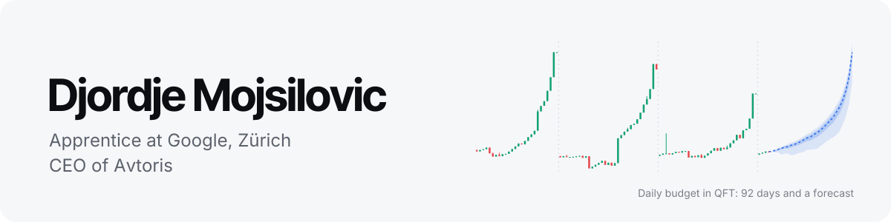
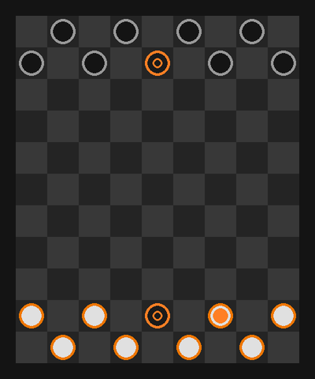
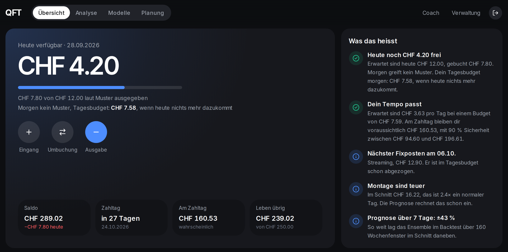
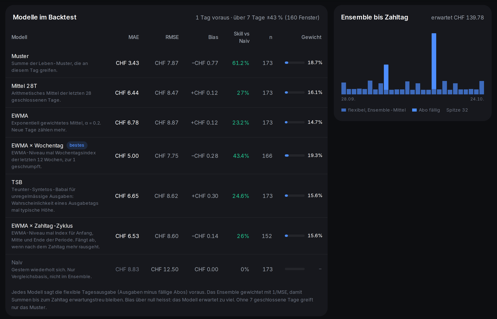

<picture>
  <source media="(prefers-color-scheme: dark)" srcset="assets/header-dark.svg">
  
</picture>

I am a first year apprentice in application development at Google in Zürich. I am also CEO of [Avtoris](https://avtoris.studio), where I lead Strategic Ops and the Research division. The first Avtoris research papers come out soon.

I want to work in quantitative finance. I learn the foundations now, and I build projects that forecast, simulate, and measure.

 

## Basketball Checker

A board game that mixes checkers and basketball, with a bot that I designed. The bot scores every legal move with a linear model and plays the best one.

I tested the bot with a Monte Carlo simulation of 5000 games:

* Against random moves, the bot wins **97.6 %**.
* Against itself, one colour wins **65 %**. The rules are the same for both teams, so this is a bias. I found the cause with controlled tests: one line in the turnover rule. With a fix, the result goes to 50 %.
* The team that has the ball first wins only **43 %**. This comes from the rules, not from a bug.

Python, Pygame. [Code, results, and method](https://github.com/DjordjeMojsilovic/basketball_checker)

 
 

## QFT · Quantitative Finance Tracker

A free budget app for apprentices in Switzerland. About 50 people use it.

Most budget apps show what you spent. QFT tells you what you can spend today, so that your money lasts until payday.

* **Forecast.** Six models predict the spend of each day. One of them is TSB, a model for intermittent demand, because many days have no spend at all.
* **Backtest.** A walk forward test scores each model against a naive baseline. The forecast is an ensemble with weights of 1 / MSE (Bates and Granger).
* **Risk.** 2000 Monte Carlo paths give a range for the balance on payday and the chance to go below zero before it.
* **Detection.** QFT finds recurring payments by itself and marks outliers with a robust z score.
* **Agents.** An API connects QFT to Grok and ChatGPT. They read a daily report and book spends.

Backtest of the six models

 

Next.js, TypeScript, Tailwind CSS, Vercel. Closed source. [Use it for free](https://qft.avtoris.studio)

 

## AssistantHub Pro

My final project in secondary school. A desk assistant on an ESP32. It runs on FreeRTOS, talks to Groq and Telegram, and tracks habits. 3368 lines of C++. It was my first project with a team of AI agents.

[Code](https://github.com/DjordjeMojsilovic/AssistantHub-Pro)

 

## How I work

I design the system, the models, and the tests. AI agents write most of the code, mainly Claude Code. I write Python, HTML, and CSS myself. Most of my projects use Next.js.

Now learning: Finance Theory I (MIT OpenCourseWare).

 

## Contributions

<picture>
  <source media="(prefers-color-scheme: dark)" srcset="https://raw.githubusercontent.com/DjordjeMojsilovic/DjordjeMojsilovic/output/github-snake-dark.svg">
  <source media="(prefers-color-scheme: light)" srcset="https://raw.githubusercontent.com/DjordjeMojsilovic/DjordjeMojsilovic/output/github-snake.svg">
  
</picture>

 

## Contact

[djordje.mojsilovic2011@gmail.com](mailto:djordje.mojsilovic2011@gmail.com) · [avtoris.studio](https://avtoris.studio)
